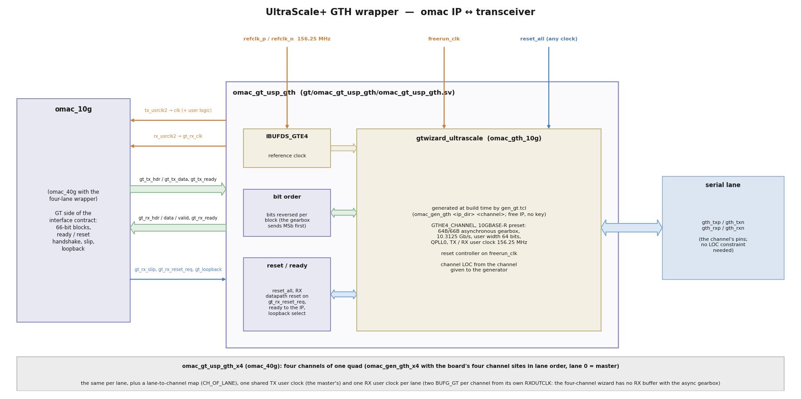

# UltraScale+ GTH wrappers

GTH channels at 10.3125 Gb/s (10GBASE-R lanes) in the transceiver's 64B/66B **asynchronous
gearbox** mode, wrapped so that they present the omac GT side of the
[interface contract](interface.md#2-gt-side-per-ip): one channel for `omac_10g`
(`omac_gt_usp_gth`), four channels of one quad for `omac_40g` (`omac_gt_usp_gth_x4`), and four
channels of one quad as four independent `omac_10g` ports (`omac_gt_usp_gth_quad`, v0.2.0-dev:
simulated in a design, synthesised, not yet on hardware). Built from
AMD's free `gtwizard_ultrascale` IP (no license key); the IP is generated by
`gt/omac_gt_usp_gth/gen_gt.tcl`, not checked in. **Maturity (v0.1.0): hardware-proven** with
both IPs on the ZCU106 (one lane at 10GBASE-R, four lanes at 40GBASE-R4, [](hardware.md)).

| File | What it is |
|---|---|
| `gen_gt.tcl` | `omac_gen_gth <ip_dir> <channel-site> ?freerun_mhz? ?module_name?` creates the gtwizard IP (default module `omac_gth_10g`, free-running clock 100 MHz) and checks the settings below; `omac_gen_gth_x4 <ip_dir> {<lane0> <lane1> <lane2> <lane3>} ...` the four-lane one (default module `omac_gth_40g`; the board's four channel sites in lane order, lane 0 = master). Always pass the board's channel site(s) ([](#board-placement)): the procs have fallback sites only so that the repository's own synthesis jobs run |
| `omac_gt_usp_gth.sv` | the one-lane wrapper: `IBUFDS_GTE4` for the reference clock, the gtwizard instance, bit order, reset/ready handshake |
| `omac_gt_usp_gth_x4.sv` | the four-lane wrapper: the same per lane, a lane-to-channel map (`CH_OF_LANE`), one shared TX user clock, **one RX user clock per lane** (two `BUFG_GT` per channel from its own `RXOUTCLK`) |
| `omac_gt_usp_gth_quad.sv` | four independent lanes (four `omac_10g`): as `_x4`, plus a **per-lane RX reset** (`RXPMARESET` of that channel only) and per-lane readiness, per-lane loopback / polarity / driver settings, QPLL lock, CDR lock, and the reference clock / 8 for a frequency monitor ([](#four-independent-lanes-omac_gt_usp_gth_quad)); generator `omac_gen_gth_quad` (module `omac_gth_quad`) |

## Usage

```tcl
# in the design's Vivado project (or non-project session)
source <omac>/gt/omac_gt_usp_gth/gen_gt.tcl
omac_gen_gth [get_property DIRECTORY [current_project]]/ip <channel-site> 100   ;# the board's GT channel, for example X0Y14
add_files <omac>/gt/omac_gt_usp_gth/omac_gt_usp_gth.sv
```



Assert `reset_all` (any clock; synchronised by the gtwizard reset controller on `freerun_clk`)
until the 156.25 MHz reference clock is stable (for example, a programmable clock generator on
the FMC must be programmed first), then release it. `gt_tx_ready` / `gt_rx_ready` follow by themselves; the omac
watchdog restarts the RX datapath if no block lock appears. The software view of these ports is
in [](#resets-and-handshake-software-view).

### Global synthesis

When the design synthesises in memory with `synth_design` (a non-project flow, or a project
flow without out-of-context IP runs), set the generated IP to global synthesis after
`omac_gen_gth` / `omac_gen_gth_x4` has created it and generate its targets again, otherwise
synthesis does not find the `omac_gth_10g` / `omac_gth_40g` module:

```tcl
set ::omac_gen_gth_noauto 1      ;# only needed when the sourcing script has its own -tclargs
source <omac>/gt/omac_gt_usp_gth/gen_gt.tcl
omac_gen_gth_x4 <ip_dir>
set xci [get_files <ip_dir>/omac_gth_40g/omac_gth_40g.xci]
set_property generate_synth_checkpoint false $xci
generate_target all $xci
```

`scripts/synth_ooc.tcl` of this repository does this.

### Clock constraints

* **Reference clock:** `create_clock -period 6.400 [get_ports <refclk_p>]` and the
  `PACKAGE_PIN` of the reference clock. The channel `LOC`s come with the IP (from the channel
  list given to the generator), so the serial pins need no constraint. Vivado derives the user
  clocks from the reference clock through the GT.
* **Clock crossings:** the IP's TX user clock and its recovered RX clock(s) are asynchronous
  (the RX clock comes from the far end). Every crossing inside the IPs is a synchroniser
  (`ASYNC_REG`), a gray-coded pointer or event counter, or quasi-static; bound them with
  `set_max_delay -datapath_only` of one `clk` period (6.4 ns at 156.25 MHz) in both
  directions. `set_clock_groups -asynchronous` on the same clocks also works but does not bound
  the gray-code skew.
* Put these constraints in an **implementation-only** XDC (`USED_IN_SYNTHESIS false`) and find
  the clocks through the channel primitives' `TXOUTCLK` / `RXOUTCLK` pins with
  `-include_generated_clocks`: the wrapper's hierarchical `tx_usrclk2` / `rx_usrclk2` pin names
  do not survive synthesis inside an IP integrator module reference.
* **An XDC file cannot use Tcl loops** (`foreach`, `concat`): Vivado reports CRITICAL WARNING
  [Designutils 20-1307] and skips the constraints. Write every pair out, or source a `.tcl`
  constraint file / hook instead.

omac_10g (one RX clock); `*<mac>*` matches the instance path of the design's MAC hierarchy:

```text
set omac_tx [get_clocks -include_generated_clocks -of_objects [get_pins -hierarchical -filter {REF_PIN_NAME == TXOUTCLK && PARENT_CELL =~ *<mac>*}]]
set omac_rx [get_clocks -include_generated_clocks -of_objects [get_pins -hierarchical -filter {REF_PIN_NAME == RXOUTCLK && PARENT_CELL =~ *<mac>*}]]
set_max_delay -datapath_only -from $omac_tx -to $omac_rx 6.400
set_max_delay -datapath_only -from $omac_rx -to $omac_tx 6.400
```

omac_40g (the TX clock and four RX clocks, 20 ordered pairs). Only the master channel's
`TXOUTCLK` carries a clock. Each channel's `RXOUTCLK` is selected through its channel
primitive; the gtwizard numbers its channels in ascending site order (for a quad of sites
X0Y12-X0Y15: 0 = X0Y12, 1 = X0Y13, 2 = X0Y14, 3 = X0Y15), and `?` stands for the brackets of
`gen_gthe4_channel_inst[c]` (escaped brackets in a filter match nothing):

```text
set omac_tx  [get_clocks -include_generated_clocks -of_objects [get_pins -hierarchical -filter {REF_PIN_NAME == TXOUTCLK && PARENT_CELL =~ *<mac>*}]]
set omac_rx0 [get_clocks -include_generated_clocks -of_objects [get_pins -of_objects [get_cells -hierarchical -filter {NAME =~ *<mac>*gen_gthe4_channel_inst?0?.GTHE4_CHANNEL_PRIM_INST}] -filter {REF_PIN_NAME == RXOUTCLK}]]
set omac_rx1 [get_clocks -include_generated_clocks -of_objects [get_pins -of_objects [get_cells -hierarchical -filter {NAME =~ *<mac>*gen_gthe4_channel_inst?1?.GTHE4_CHANNEL_PRIM_INST}] -filter {REF_PIN_NAME == RXOUTCLK}]]
set omac_rx2 [get_clocks -include_generated_clocks -of_objects [get_pins -of_objects [get_cells -hierarchical -filter {NAME =~ *<mac>*gen_gthe4_channel_inst?2?.GTHE4_CHANNEL_PRIM_INST}] -filter {REF_PIN_NAME == RXOUTCLK}]]
set omac_rx3 [get_clocks -include_generated_clocks -of_objects [get_pins -of_objects [get_cells -hierarchical -filter {NAME =~ *<mac>*gen_gthe4_channel_inst?3?.GTHE4_CHANNEL_PRIM_INST}] -filter {REF_PIN_NAME == RXOUTCLK}]]
set_max_delay -datapath_only -from $omac_tx  -to $omac_rx0 6.400
set_max_delay -datapath_only -from $omac_tx  -to $omac_rx1 6.400
set_max_delay -datapath_only -from $omac_tx  -to $omac_rx2 6.400
set_max_delay -datapath_only -from $omac_tx  -to $omac_rx3 6.400
set_max_delay -datapath_only -from $omac_rx0 -to $omac_tx  6.400
set_max_delay -datapath_only -from $omac_rx0 -to $omac_rx1 6.400
set_max_delay -datapath_only -from $omac_rx0 -to $omac_rx2 6.400
set_max_delay -datapath_only -from $omac_rx0 -to $omac_rx3 6.400
set_max_delay -datapath_only -from $omac_rx1 -to $omac_tx  6.400
set_max_delay -datapath_only -from $omac_rx1 -to $omac_rx0 6.400
set_max_delay -datapath_only -from $omac_rx1 -to $omac_rx2 6.400
set_max_delay -datapath_only -from $omac_rx1 -to $omac_rx3 6.400
set_max_delay -datapath_only -from $omac_rx2 -to $omac_tx  6.400
set_max_delay -datapath_only -from $omac_rx2 -to $omac_rx0 6.400
set_max_delay -datapath_only -from $omac_rx2 -to $omac_rx1 6.400
set_max_delay -datapath_only -from $omac_rx2 -to $omac_rx3 6.400
set_max_delay -datapath_only -from $omac_rx3 -to $omac_tx  6.400
set_max_delay -datapath_only -from $omac_rx3 -to $omac_rx0 6.400
set_max_delay -datapath_only -from $omac_rx3 -to $omac_rx1 6.400
set_max_delay -datapath_only -from $omac_rx3 -to $omac_rx2 6.400
```

These constraints are validated on hardware for both MACs. Check them in the routed design with
`report_clock_interaction`: every pair of these clocks should read "Max Delay Datapath Only".

## Resets and handshake (software view)

The wrappers have one reset input for the design (`reset_all`); everything else on the reset
side is a handshake with the omac IP that software never drives. Ports of `omac_gt_usp_gth`
(`omac_gt_usp_gth_x4`: the same, with the per-lane vectors noted):

| Port | Dir | Clock | Software rule |
|---|---|---|---|
| `freerun_clk` | in | - | the gtwizard reset controller's clock (100 MHz by default, `gen_gt.tcl` `freerun_mhz`). Must run before and during `reset_all` and never stop: a clock independent of the transceiver (on Zynq UltraScale+ a PS `pl_clk`) |
| `reset_all` | in | any (synchronised on `freerun_clk` inside the gtwizard) | gtwizard `gtwiz_reset_all_in`: resets the PLL and both datapaths. **Hold it from power-up until the reference clock is stable at 156.25 MHz** (for example, a programmable clock generator on the FMC programmed and locked first), then release it once. Pulse it again only after the reference clock was lost or changed (a "relink" is the omac `rst`, not this). While it is held, and until `gt_tx_ready` = 1, `tx_usrclk2` (= the omac `clk`) does not run: every register clocked by `clk` is unreachable |
| `gt_tx_ready` | out | `tx_usrclk2` / reset controller (the omac IP synchronises it) | `gtwiz_reset_tx_done_out && gtwiz_userclk_tx_active_out`: PLL locked, TX datapath out of reset, TX user clock running. 0 while `reset_all` is held. The omac IP keeps itself in reset while it is 0. Export it as status; if it never comes: no or wrong reference clock, wrong reference clock site, no transceiver power (`gt_powergood` = 0). Software can wait up to about 1 s for it (polling every 1 ms), then check `clk` with a frequency meter (allow the meter one full integration period after `gt_tx_ready` before it reads 156.25 MHz) |
| `gt_rx_ready` | out | as above | `gtwiz_reset_rx_done_out && gtwiz_userclk_rx_active_out` (x4: all four RX user clocks active). It also falls during every RX datapath reset, i.e. on every `gt_rx_reset_req` of the omac watchdog: while no partner is present it blinks every 13.4 ms. A low `gt_rx_ready` while the link is down is therefore not a fault by itself |
| `gt_rx_reset_req` | in | omac `clk` (64-cycle pulse) | driven by the omac RX watchdog only, into `gtwiz_reset_rx_datapath_in`. Software does not drive it; a design that wants its own RX reset ORs it in |
| `gt_rx_slip` | in | `rx_usrclk2` | driven by the omac block lock only: one `RXGEARBOXSLIP` pulse per one-bit shift of the block boundary, `SLIP_WAIT` cycles apart (at most 66 slips, ~0.14 ms to lock). The gearbox alignment is entirely between the IP and the transceiver; software has no part in it |
| `gt_loopback` | in | omac `clk` | driven by the omac IP from `ctl_loopback`; software sets `ctl_loopback`, never this port |
| `tx_polarity`, `rx_polarity` (x4: per lane), `tx_diffctrl`, `tx_postcursor`, `tx_precursor`, `rx_lpmen` | in | static | board settings: fix them at build time (for example as parameters of the design's MAC module). Changing them at run time has not been validated; a design that does should treat it as a relink |
| `gt_powergood` (x4: per lane) | out | static | the transceiver's power-good; export it as status (0: no transceiver power) |
| `tx_usrclk2`, `rx_usrclk2` (x4: per lane) | out | - | the omac `clk` and `gt_rx_clk`; both stop while their side is in reset (the user clocking helpers are held until the PMA and the programmable divider are out of reset) |

Build-time parameters, never changed by software: `BIT_REVERSE`, and for the four-lane wrapper
`CH_OF_LANE`.

## gtwizard settings (Vivado 2025.2, gtwizard_ultrascale 1.7)

Read back from the generated IP on this flow (`gen_gt.tcl` refuses to continue if any of the
checked values differs):

| Setting | Value | Note |
|---|---|---|
| preset | `GTH-10GBASE-R` | |
| line rate TX / RX | 10.3125 Gb/s | |
| PLL | QPLL0, `QPLL0_FBDIV` 66, `QPLL0_REFCLK_DIV` 1 | from 156.25 MHz |
| reference clock | 156.25 MHz, `MGTREFCLK0` of the channel's quad (`"<channel> clk0"`) | |
| TX / RX data encoding | `64B66B_ASYNC` (asynchronous gearbox) | `TXSEQUENCE` tied to 0 |
| internal data width | 32 | **the only value the GTH accepts** (64 is refused: "Valid values are - 32"; 64-bit internal width exists on GTY only) |
| user data width | 64 | `TXUSRCLK` 312.5 MHz, `TXUSRCLK2` **156.25 MHz** (ratio 2); RX the same |
| TX / RX OUTCLK source | `TXPROGDIVCLK` / `RXPROGDIVCLK` (312.5 MHz) | preset |
| RX PPM offset | 200 | preset |
| RX equalisation | `AUTO` (port `rxlpmen`: 0 = DFE, 1 = LPM) | DFE for passive copper |
| user clocking helpers | in the core (`LOCATE_TX/RX_USER_CLOCKING CORE`) | reset by `~(PRGDIVRESETDONE && PMARESETDONE)`, as in AMD's example design |
| free-running clock | 100 MHz default (`freerun_mhz`) | any clock that runs before the GT |
| optional ports | loopback, polarity TX/RX, txdiffctrl, txpost/precursor, rxlpmen, gtpowergood, tx/rx pmaresetdone | |
| gearbox ports | `txheader[5:0]`, `txsequence[6:0]`, `rxheader[5:0]`, `rxheadervalid[1:0]`, `rxdatavalid[1:0]`, `rxgearboxslip`, `rxstartofseq[1:0]` | |

**Bit order.** AMD's gtwizard example design for this mode states that "gearbox modes transmit
data MSb first" and bit-reverses its PRBS data. The wrapper therefore reverses the 64 data bits
and swaps the two header bits in both directions (`BIT_REVERSE` = 1), so the omac side keeps
IEEE 802.3 order (bit 0 first). With it a data block (IEEE sync header "01") appears on
`TXHEADER[1:0]` as `2'b01`. **Confirmed on hardware** (ZCU106 against a ConnectX-6 Dx: block
lock, alignment and error-free traffic on the first power-up on one lane at 10G and on all four
lanes at 40G). A wrong bit order does **not** prevent block lock: block lock only tests that the
two sync header bits differ, which swapping them keeps. It would show as errored blocks on every
block at 10G and as block lock without alignment-marker lock at 40G (derived from the RTL;
`BIT_REVERSE` = 0 exists for that experiment). A P/N swap looks the same, on the affected lane
only.

**RX valid.** `gt_rx_valid` = `RXDATAVALID[0] && RXHEADERVALID[0]`. At 64-bit user width the
asynchronous gearbox delivers one block per `RXUSRCLK2` cycle; the qualifiers are honoured
anyway.

**Slip.** The omac block lock waits `SLIP_WAIT` (256) `RXUSRCLK2` cycles after each
`RXGEARBOXSLIP` pulse before testing headers again; AMD's example design also slips at most once
per 256 cycles. Worst case 66 slips: about 22k cycles (0.14 ms) to lock.

## Four lanes (omac_gt_usp_gth_x4, 40GBASE-R4)

Read back from a four-channel IP generated on this flow (Vivado 2025.2):

| Setting | Value | Note |
|---|---|---|
| `CHANNEL_ENABLE` | the four channel sites given (sorted) | the IP indexes its channel vectors in ascending site order (quad X0Y12-X0Y15: X0Y12 = 0 ... X0Y15 = 3) |
| `TX_MASTER_CHANNEL` / `RX_MASTER_CHANNEL` | the first channel given (lane 0) | |
| `TX/RX_REFCLK_SOURCE` | `<master> clk0` | one entry: MGTREFCLK0 of the quad (a per-channel list is refused) |
| TX buffer | on (`TX_BUFFER_MODE` 1) | all four lanes on the master's TX user clock (helper in the core) |
| RX | asynchronous gearbox, `RXBUF_EN` FALSE in the channel | each lane's gearbox output must run on that lane's own recovered clock |
| `LOCATE_RX_USER_CLOCKING` | `EXAMPLE_DESIGN` | the wrapper builds the four RX user clocks (`rxoutclk_out[c]` -> `BUFG_GT` DIV 1 -> `rxusrclk_in[c]` 312.5 MHz, `BUFG_GT` DIV 2 -> `rxusrclk2_in[c]` 156.25 MHz, both cleared until `RXPRGDIVRESETDONE && RXPMARESETDONE`), `gtwiz_userclk_rx_active_in` = all four active |

Port vectors (`gt_tx_*`, `gt_rx_*`, `gth_*`, `tx/rx_polarity`, `rx_usrclk2`) are indexed by
**lane** (omac_40g PCS lane on transmit = the board's lane l, with `CH_OF_LANE` set from the
board's lane order); `CH_OF_LANE[2l +: 2]` is the gtwizard channel index of lane l
([](#board-placement)). Resources: 4 GTHE4_CHANNEL, 1 GTHE4_COMMON, 10 BUFG_GT
(2 TX + 8 RX).

**Per-lane RX clocks.** With the asynchronous gearbox the four-channel gtwizard turns the RX
elastic buffer off (`RXBUF_EN` FALSE), so each lane's received blocks leave the channel on that
lane's own recovered clock; one shared RX user clock (as on transmit) would corrupt the other
three lanes. The wrapper therefore gives every lane its own pair of `BUFG_GT`s, and omac_40g
takes the four clocks as `gt_rx_clk[3:0]`: per-lane block lock, marker lock and BIP check run
in the lane's clock, and the deskew FIFOs move the lanes into the clock of `RX_CLK_LANE`
(default lane 0). Proven on hardware (all four lanes aligned at 0-1 block of skew against a
ConnectX-6 Dx).

## Four independent lanes (omac_gt_usp_gth_quad)

Four `omac_10g` on the four channels of one quad (for example the four cages of a quad SFP+ /
SFP28 card) cannot use `omac_gt_usp_gth_x4` as it is: its RX reset (`gt_rx_reset_req`) and
readiness (`gt_rx_ready`) are common to the four lanes, so the RX watchdog of a port without a
signal (an empty cage) would reset the receivers of the other three every 13.4 ms and take their
links down. Four one-channel IPs are no alternative either: each would bring its own
`GTHE4_COMMON` into the one quad.

`omac_gt_usp_gth_quad` keeps one four-channel gtwizard (one QPLL0, one TX user clock for the four
MACs, one RX user clock per lane, as `_x4`) and adds, per lane:

| Port | Dir | Description |
|---|---|---|
| `gt_rx_reset_req[3:0]` | in | lane l's RX reset request (its omac watchdog, or software); any clock, a pulse of >= 2 `freerun_clk` cycles. A rising edge holds that channel's `RXPMARESET` for `RST_CYCLES` (32) `freerun_clk` cycles, then waits for its `RXRESETDONE` to fall and to rise again (bounded waits); the other channels are not touched. The gtwizard's common RX datapath reset is not used |
| `gt_rx_ready[3:0]` | out | lane l ready: the IP's RX reset done, lane l's RX user clock active, its `RXRESETDONE`, no per-lane reset in progress (registered in `freerun_clk`) |
| `gt_loopback[11:0]`, `tx_polarity[3:0]`, `rx_polarity[3:0]`, `tx_diffctrl[19:0]`, `tx_postcursor[19:0]`, `tx_precursor[19:0]`, `rx_lpmen[3:0]` | in | per lane (lane l at `[3l +: 3]` / `[5l +: 5]` / `[l]`) |
| `qpll_lock`, `rx_cdr_lock[3:0]`, `rx_reset_busy[3:0]` | out | status |
| `refclk_mon` | out | the reference clock / 8 (`IBUFDS_GTE4` `ODIV2` -> `BUFG_GT` DIV 8, 19.53 MHz at 156.25 MHz): it runs whenever the reference clock does, independent of every transceiver reset, for a frequency monitor in the design (for example to hold `reset_all` until a programmable clock generator delivers 156.25 MHz, as the bring-up sequence asks) |

The gtwizard of `omac_gen_gth_quad` is the `omac_gen_gth_x4` one plus the per-channel optional
ports `rxpmareset_in`, `rxresetdone_out`, `rxcdrlock_out` and `qpll0lock_out` (Vivado accepts
`rxpmareset_in` but not `gtrxreset_in` or `rxprogdivreset_in`, which the reset helper drives).
The helper's own RX state machine only watches the PLL lock once it is done, so a per-lane
`RXPMARESET` does not disturb it; the lane's RX user clock is cleared while its
`RXPMARESETDONE` is low and restarts with it.

**TX user clock as a time base.** The shared `tx_usrclk2` is the `clk` of the four MACs; it is
derived from the quad's QPLL0 and therefore a fixed multiple of the reference clock: a design
can use it as its time-of-day clock (the timestamp hooks of `omac_10g` then sample it without a
clock crossing on the transmit side). It stops while `reset_all` is held.

Resources (synthesis with four `omac_10g` with timestamp hooks, `make synth-gt`):
4 GTHE4_CHANNEL, 1 GTHE4_COMMON, 11 BUFG_GT (2 TX + 8 RX + 1 monitor), [](resources.md).
**Not yet validated on hardware** (the per-lane `RXPMARESET` recovery in particular).

## Board placement

The wrappers and the generator are not tied to a board. A design determines, for its board and
connector, the GT channel site of each QSFP / SFP lane in lane order (the channel list given to
`omac_gen_gth` / `omac_gen_gth_x4`, lane 0 first: it is the master), the reference clock input
of that quad (the generator uses `MGTREFCLK0`, `"<master> clk0"`) with its package pin and its
156.25 MHz source, which must be stable before `reset_all` is released (for example, a
programmable clock generator on the FMC must be programmed first), the four-lane wrapper's
`CH_OF_LANE`, and the lane polarity where the board swaps P and N (`tx_polarity` /
`rx_polarity` of that lane). These facts come from the board's and the FMC's pinout; for Opsero
FMC cards the [FPGA Board Repository](https://boards.fpgadeveloper.com) generates the constraints
for each supported carrier and connector. A complete worked example (lane-to-site list,
reference clock pin and clock generator, lane map, constraints) is referenced on the
[projects page](projects.md).

* **One lane on a QSFP port (omac_10g):** a QSFP host forced to 10G uses **QSFP lane 0** (a
  ConnectX-6 Dx forced to `10000baseCR` does, confirmed in hardware validation), so give
  `omac_gen_gth` the channel of the port's lane 0.
* **Lane map (`CH_OF_LANE`):** the gtwizard numbers its four channels in ascending site order,
  and boards often route the QSFP lanes in another order. Set `CH_OF_LANE[2l +: 2]` to the
  channel index of lane l: for example, lanes 0-3 on sites X0Y14, X0Y13, X0Y15, X0Y12 of a quad
  X0Y12-X0Y15 give indices 2, 1, 3, 0, i.e. `{2'd0, 2'd3, 2'd1, 2'd2}` (the parameter's default
  value, an example, not a board default). 40GBASE-R does not need the map (the receiver
  reorders by alignment marker), but with the right map omac_40g PCS lane l leaves on QSFP lane
  l, which keeps lane-specific debugging (BIP errors, `stat_lane_*`) readable. In hardware
  validation the ConnectX-6 Dx sent PCS lane l on QSFP lane l, so `stat_lane_map` read the
  identity.
* **Reference clock constraint:** `set_property PACKAGE_PIN <refclk-pin> [get_ports <refclk_p>]`
  and `create_clock -period 6.400 [get_ports <refclk_p>]`; the channel `LOC`s come with the IP.
