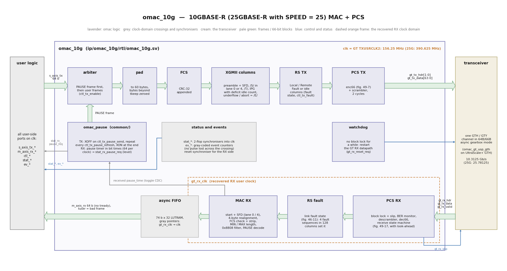

# omac_10g: 10GBASE-R (25GBASE-R) MAC + PCS

**Maturity (v0.1.0): 10GBASE-R hardware-proven** on a ZCU106 with the Opsero 2x QSFP28 FMC
against an NVIDIA ConnectX-6 Dx ([](hardware.md)). **25GBASE-R** (`SPEED` = 25): simulated and
timing-closed at 390.625 MHz, not yet on hardware (it needs the planned GTY wrapper).

`omac_10g` is a single-lane Ethernet MAC + 64B/66B PCS with a 64-bit AXI-Stream user side on
one clock. It implements the omac boundary contract ([](interface.md))
and drives one transceiver in 64B/66B asynchronous gearbox mode
([](gt_usp_gth.md) on UltraScale+ GTH). Written from
scratch from IEEE 802.3 clauses 46 (RS, XGMII, link fault signalling), 49 (10GBASE-R PCS) and
annex 31B (PAUSE); no third-party RTL.

| | 10GBASE-R (`SPEED` = 10) | 25GBASE-R (`SPEED` = 25) |
|---|---|---|
| lane rate | 10.3125 Gb/s | 25.78125 Gb/s |
| `clk` = GT TXUSRCLK2 | 156.25 MHz | 390.625 MHz |
| transceiver | GTH or GTY | GTY only (no wrapper yet) |
| logic | identical | identical; BER monitor defaults 2 ms / 97 (clause 107) |
| status | hardware-proven (ZCU106 + ConnectX-6 Dx), routed at 156.25 MHz on xczu7ev-2 (+2.8 ns) | simulated (PAUSE, frames), routed at 390.625 MHz on xcku5p-2 (+0.28 ns); no GTY wrapper / hardware yet |

25GBASE-R without RS-FEC (clause 108) and without auto-negotiation: what a link partner forced to
25G with FEC off expects. RS-FEC is not implemented.

## Architecture



The diagram is generated by `docs/images/gen_block_diagram.py` (Python 3 with matplotlib).

| Module | File | Clock | Function |
|---|---|---|---|
| `omac_10g` | `rtl/omac_10g.sv` | both | top: resets, crossings, RS transmit mux, PAUSE, watchdog |
| `omac_10g_mac_tx` | `rtl/omac_10g_mac_tx.sv` | clk | arbiter (PAUSE first), 60-byte pad, FCS, XGMII columns: /S/ in lane 0 or 4, deficit idle count, /T/, underflow and abort as /E/ |
| `omac_10g_pcs_tx` | `rtl/omac_10g_pcs_tx.sv` | clk | `enc66` (figure 49-7) + scrambler; 2 cycles |
| `omac_10g_pcs_rx` | `rtl/omac_10g_pcs_rx.sv` | rx | `omac_block_lock`, `omac_ber_mon`, descrambler, `dec66`, receive state machine (figure 49-17: a /T/ block counts only if the next block is /S/ or /C/; errors become /E/ columns; no lock or hi_ber = Local Fault columns) |
| `omac_rs_fault` | `common/` | rx | link fault state (figure 46-11): 4 fault sequences of one type within 128 columns each set it, 128 columns without clear it |
| `omac_10g_mac_rx` | `rtl/omac_10g_mac_rx.sv` | rx | start + SFD (lane 0 or 4), 4-byte realignment, FCS residue check + strip, MIN/MAX length, MAC Control (0x8808) filter, PAUSE decode |
| `omac_async_fifo` | `common/` | rx → clk | 74-bit x 32 LUTRAM FIFO, gray pointers |
| `omac_pause` | `common/` | clk | received pause timer in bit times (64 per clock), XOFF / refresh / XON requests |
| `omac_10g_bd` | `rtl/omac_10g_bd.v` | | Verilog wrapper for IP integrator (generated by `scripts/gen_bd_wrapper.py`) |

### Transmit path in detail

* **Arbiter.** At frame boundaries a pending PAUSE request goes first (also while
  `ctl_pause_tx_honour` holds user frames back), then a user frame if `ctl_tx_enable` = 1 and no
  honoured pause is in force.
* **Pad + FCS.** Bytes beyond `tkeep` are zeroed; frames shorter than 60 bytes are padded with
  zero beats; the CRC-32 is appended. A last beat with more than 4 bytes needs one extra beat for
  the FCS (the input stalls one cycle).
* **Columns.** One XGMII column (8 lanes) per cycle. /S/ goes in lane 0 (block type 0x78) or lane
  4 (0x33). The gap from /T/ (inclusive) to the next /S/ is at least `9 + dic` bytes and /S/
  sits on a 4-byte boundary; `dic` (0..3) is the deficit idle count, so the average gap is 12
  bytes and every gap is 9-15 bytes when frames are back to back (simulation: mean 11.97-12.0
  over 58 frames, sum >= 12 n - 3). Lane-4 frames hold 4 bytes of each beat for the next
  column.
* **Errors.** If the next beat is missing inside a frame (`tvalid` low) the column becomes all
  /E/ (the PCS sends an error block), `ev_tx_underflow` pulses and the rest of the frame is
  drained; `tuser` on a beat does the same with `ev_tx_abort`.
* **RS.** `ctl_tx_fault` sends Local Fault (block 0x55, both halves /Q/ 00 00 01); a local fault
  at our receiver sends Remote Fault (00 00 02); a received Remote Fault sends idles. Frames
  keep being consumed in both cases.

### Receive path in detail

* **Block lock** tests one sync header per valid block (figure 49-14): 64 good headers in a row
  give lock; while unlocked any bad header, while locked 16 bad headers within 64, slip the
  gearbox by one bit and wait `SLIP_WAIT` cycles.
* **BER monitor** (figure 49-15): `BER_THRESH` bad headers within `BER_TIMER_CLKS` set hi_ber;
  a window with fewer clears it.
* **Decoder + state machine.** Every block is decoded (figure 49-7, invalid → /E/ column); the
  figure 49-17 state machine replaces out-of-sequence blocks with /E/ and needs one block of
  look-ahead (`ev_rx_bad_block`, `ev_rx_sequence_error`).
* **MAC.** A frame starts with /S/ in lane 0 (SFD in lane 7) or in lane 4 (SFD in lane 3 of the
  next column); a start without SFD is ignored. The first control character ends the frame; it
  must be /T/, otherwise the frame is bad. The CRC over the frame including the FCS must leave
  the residue 0xDEBB20E3. The last 4 bytes are stripped with one word of delay. Frames of 4
  bytes or less are dropped (`ev_rx_frame_bad`). EtherType 0x8808 is known at the moment word 0
  would leave, so MAC Control frames never appear on `m_axis_rx`.
* **Clock crossing.** Data beats only go into the FIFO, at most one per recovered-clock cycle;
  frames carry at least 20 bytes of preamble and gap per frame, so even with the far end 200 ppm
  fast the FIFO stays near empty (32 entries). A gap of one `clk` cycle inside a frame appears
  when the recovered clock is the slower one.

## Instantiation (with the GTH wrapper)

```systemverilog
omac_gt_usp_gth u_gt (
    .refclk_p(gt_refclk_p), .refclk_n(gt_refclk_n), .freerun_clk(clk_100), .reset_all(gt_reset),
    .gth_rxp(rxp), .gth_rxn(rxn), .gth_txp(txp), .gth_txn(txn),
    .tx_usrclk2(mac_clk), .gt_tx_ready(gt_tx_ready), .gt_tx_hdr(gt_tx_hdr), .gt_tx_data(gt_tx_data),
    .rx_usrclk2(gt_rx_clk), .gt_rx_ready(gt_rx_ready), .gt_rx_valid(gt_rx_valid),
    .gt_rx_hdr(gt_rx_hdr), .gt_rx_data(gt_rx_data), .gt_rx_slip(gt_rx_slip),
    .gt_rx_reset_req(gt_rx_reset_req), .gt_loopback(gt_loopback),
    .tx_polarity(1'b0), .rx_polarity(1'b0), .tx_diffctrl(5'b11000), .tx_postcursor(5'd0),
    .tx_precursor(5'd0), .rx_lpmen(1'b0), .gt_powergood());

omac_10g u_mac (
    .clk(mac_clk), .rst(mac_rst),                  // user logic runs on mac_clk too
    .s_axis_tx_tdata(...), /* ... the AXI-Streams, ctl_*, stat_*, ev_* ... */
    .gt_tx_ready(gt_tx_ready), .gt_tx_hdr(gt_tx_hdr), .gt_tx_data(gt_tx_data), .gt_loopback(gt_loopback),
    .gt_rx_clk(gt_rx_clk), .gt_rx_ready(gt_rx_ready), .gt_rx_valid(gt_rx_valid), .gt_rx_hdr(gt_rx_hdr),
    .gt_rx_data(gt_rx_data), .gt_rx_slip(gt_rx_slip), .gt_rx_reset_req(gt_rx_reset_req));
```

`ip/omac_10g/synth/omac_10g_gth_top.sv` is a complete example (it is the synthesis check of the
pair). Generate the transceiver with `omac_gen_gth <ip_dir> <channel-site>` (the board's GT
channel, on a QSFP port that of lane 0; see [](gt_usp_gth.md#board-placement); for
an in-memory `synth_design` flow set the IP to
[global synthesis](gt_usp_gth.md#global-synthesis)). The logic behind the MAC connects as in
[](interface.md#4-connecting-a-consumer), with a 64-bit stream.

## Bring-up and software

What a design's software does with omac_10g, through the design's own registers (the repository
ships no driver; the register set is in [](interface.md#6-software-contract)). See the
[projects page](projects.md) for a worked example: a design's bring-up code, its registers and
its status dump.

### Sequence

| Step | Software | Wait for | Time |
|---|---|---|---|
| 1 | power-up: transceiver (`reset_all`) and MAC (`rst`) held in reset, `ctl_tx_enable` = `ctl_rx_enable` = 0 | | the reset values of the design's registers |
| 2 | make the reference clock stable at 156.25 MHz (if it comes from a programmable clock generator, for example on the FMC: program it, typically over I2C) | the clock chip's lock / calibration | the chip's own lock time (a fixed wait of some tens of milliseconds after programming is a simple choice) |
| 3 | release `reset_all`, keep `rst` | `gt_tx_ready` = 1 and `clk` running (a "MAC clock alive" bit or a frequency meter: 156.25 MHz) | normally milliseconds; poll every 1 ms with a limit of about 1 s ([](gt_usp_gth.md#resets-and-handshake-software-view)) |
| 4 | release `rst` | | |
| 5 | write `ctl_mac_addr` and the PAUSE values, then `ctl_rx_enable` = `ctl_tx_enable` = 1 (`ctl_loopback` if wanted) | | |
| 6 | poll `stat_link_up` (or take the link-change interrupt) | `stat_link_up` = 1 | the IP itself needs well under a millisecond once a signal is present (block lock at most ~22k cycles = 0.14 ms, then 128 columns for the fault states to clear). **On hardware, from step 4: a few seconds** (under 6 s against a ConnectX-6 Dx forced to 10000, [](hardware.md#omac_10g-10gbase-r)), dominated by the partner's own link-up. Allow 10 s before reporting "no link" |
| 7 | snapshot or clear the counters | | |

The link partner must be forced to 10 Gb/s with auto-negotiation and FEC off (25GBASE-R:
forced 25 Gb/s, FEC off). Software does not need to pulse `rst` while it waits for the link (a
pulse is harmless): the RX watchdog restarts the transceiver's RX datapath every 13.4 ms by
itself while there is no lock.

### Link loss

* **Detect** it by the falling edge of `stat_link_up` (causes:
  [](interface.md#161-what-stat_link_up-means)). Latch both edges, or count link-down events, in
  the always-on block; a poll every 100 ms misses short drops.
* **While down** the IP keeps working on its own: if our receiver lost the signal it sends Remote
  Fault, if the partner reports Remote Fault it sends idles; frames handed to it are still
  accepted at line rate and discarded (`ev_tx_frame` still counts them); the RX watchdog pulses
  `gt_rx_reset_req` every 13.4 ms until block lock returns. The link comes back without any
  software action once the partner is back.
* **React** in the layers above (hold or flush traffic that must not be lost, note the cause
  from `stat_block_lock` / `stat_hi_ber` / the faults); at link-up snapshot the counters. A `rst`
  pulse is the "relink" control. A `reset_all` pulse is needed only after the reference clock
  was lost or changed; it stops `clk`.
* The time to recover after a cable reconnect or a partner restart was not measured separately;
  it is bounded by the partner's own link-up, as in the bring-up times above.

### Loopback

`ctl_loopback` = 1 switches the transceiver to near-end PMA loopback (`LOOPBACK` 3'b010;
`LOOPBACK_MODE` = 3'b001 selects near-end PCS at build time): the receiver gets our own
transmitter, so the whole IP, the gearbox and the serialiser are in the loop. The change is a
link event: block lock is lost and found again on the new source, `stat_link_up` drops for the
relock, frames in flight are lost. While it is set the partner still receives everything we
transmit (the loopback test traffic too) and nothing it sends reaches us. Software writes the
bit, then treats it as a relink (optionally a `rst` pulse, then wait for `stat_link_up` as at
bring-up and snapshot the counters); this works with the cable to the partner still connected
([](hardware.md#omac_10g-10gbase-r)). Clearing it is the same relink, back to the partner.

### PAUSE (802.3x)

* **What the MAC does by itself:** it consumes every MAC Control frame; a valid PAUSE frame loads
  the receive timer, and `stat_rx_pause_req` stays high for `pause_time` quanta of 512 bit
  times = **51.2 ns = 8 `clk` cycles** at 10G (20.48 ns at 25G; 0xFFFF = 3.36 ms at 10G), an
  XON clears it; with `ctl_pause_tx_honour` = 1 it holds its own transmit between frames. On
  transmit it turns the level `ctl_tx_pause_send` into XOFF (rising edge), XOFF refreshes (every
  `ctl_tx_pause_refresh` quanta while high) and one XON (falling edge), sent ahead of data at the
  next frame boundary, with `ctl_mac_addr` as the source address.
* **What the design must do:** decide when to ask for PAUSE and drive `ctl_tx_pause_send` from
  hardware (typically a receive FIFO level with hysteresis: ask above a high mark, release
  below a low mark); pick the quanta and the refresh (refresh below the quanta; at 10G
  0x100 = 13.1 µs and 0x80 = 6.6 µs); either set `ctl_pause_tx_honour` = 1 or make its own TX
  scheduler honour `stat_rx_pause_req`; give software an enable for each direction.
* **Software** sets those enables and values, and watches `ev_tx_pause` / `ev_rx_pause` (counters)
  and `stat_tx_pause_active` / `stat_rx_pause_req` (live state). Only global 802.3x PAUSE is
  implemented (no priority flow control, 802.1Qbb); the partner must have PAUSE enabled
  (`ethtool -A <if> rx on tx on`).
* PAUSE frames have not been exchanged on a 10G link yet; the same `omac_pause` block is
  hardware-proven at 40G ([](omac_40g.md#pause-8023x)).

### Counters and a healthy status dump

After traffic, a healthy link reads: link up, block
lock 1, hi BER 0, local and remote fault 0; RX frames counting, **bad FCS 0, errored blocks
(`ev_rx_bad_block`) 0 since link-up**, TX frames counting, TX underflow 0, link drops 0. Errored
blocks counted while the link was being acquired are normal (clear or snapshot at link-up).

### When it does not link: debug order

| Step | Look at | Expect | If not |
|---|---|---|---|
| 1 | `gt_powergood`, `gt_tx_ready`, `gt_rx_ready`, the measured `clk` | 1, 156.25 MHz (25G: 390.625) | reference clock missing or at the wrong frequency (program the clock chip before `reset_all`; pulse `reset_all` after fixing it), wrong reference clock pin or quad, no transceiver power |
| 2 | `stat_block_lock` | 1 | no signal on the lane: cable or module (QSFP `ModPrsL`, `ResetL`, `LPMode`), partner not forced to 10G, or the **wrong lane**: a QSFP host forced to 10G uses **QSFP lane 0** (a ConnectX-6 Dx forced to `10000baseCR` does, confirmed on hardware), so omac_10g must sit on the transceiver channel of QSFP lane 0 ([](gt_usp_gth.md#board-placement)). Meanwhile `gt_rx_reset_req` pulses every 13.4 ms. Not caused by the bit order or a P/N swap: block lock only tests that the two sync header bits differ, which both keep |
| 3 | `ev_rx_bad_block` after lock | not counting | counting at the block rate (`stat_link_up` can even read 1, no good frame arrives): wrong bit order (`BIT_REVERSE`; 1 is right for the UltraScale+ GTH wrapper), a P/N swap on the receive lane (`rx_polarity`), or a partner that sends 64B/66B at 10.3125 Gb/s but not 10GBASE-R (one lane of a 40GBASE-R4 link: the partner is at 40G). Derived from the RTL, not observed on hardware |
| 4 | `stat_hi_ber` | 0 | signal integrity: cable, connector, equalisation (`rx_lpmen`: 0 = DFE for passive copper), transmit swing (`tx_diffctrl`) at either end |
| 5 | `stat_local_fault` | 0 | we do not receive properly (steps 2-4), or the far end's PHY sends Local Fault |
| 6 | `stat_remote_fault` | 0 | the partner does not receive us: our transmit lane (wrong channel, `tx_polarity`, `BIT_REVERSE` applies to transmit too), the partner's rate / FEC / admin state; check the partner's side (`ethtool`, its counters) |
| 7 | `stat_link_up`, then `ev_rx_frame_good`, `ev_rx_fcs_error`, `ev_rx_bad_block`, `ev_tx_underflow` | link up, frames, no errors | FCS errors without errored blocks: frames damaged above the PCS (for example a transmit underflow at the far end); `ev_tx_underflow` at our end: the TX source leaves gaps inside frames |

## Parameters

| Parameter | Default | Description |
|---|---|---|
| `DATA_WIDTH` | 64 | fixed (checked) |
| `SPEED` | 10 | 10 or 25; selects the BER monitor defaults; the logic is the same |
| `MIN_FRAME` | 64 | received frames shorter (with FCS) are bad (`ev_rx_runt`) |
| `MAX_FRAME` | 9600 | received frames longer (with FCS) are cut, bad (`ev_rx_oversize`) |
| `PAUSE_EN` | 1 | 802.3x PAUSE timer and transmission |
| `TX_PAD` | 1 | 0 disables the 60-byte padding (tests only: produces runts) |
| `SLIP_WAIT` | 256 | cycles after a gearbox slip before headers are tested |
| `BER_TIMER_CLKS` | 19532 (25G: 781250) | BER window in `gt_rx_clk` cycles (125 µs; 2 ms) |
| `BER_THRESH` | 16 (25G: 97) | bad headers per window for hi_ber |
| `RX_WATCHDOG` | 2097152 | `clk` cycles (13.4 ms at 156.25 MHz) without lock (or with hi_ber) before `gt_rx_reset_req`; must exceed the lock search (~22k cycles) |
| `RX_FIFO_DEPTH` | 32 | RX clock-crossing FIFO entries |
| `LOOPBACK_MODE` | 3'b010 | GT `LOOPBACK` code for `ctl_loopback` (near-end PMA; 3'b001 near-end PCS) |
| `SCR_INIT` | all ones | scrambler state after reset (any value; the far end self-synchronises) |

## Timing and constraints

* `clk` 156.25 MHz (6.4 ns) at 10G; `gt_rx_clk` the same nominal frequency, asynchronous.
* Constrain the crossings between the two clocks in an **implementation-only** XDC on the
  channel's `TXOUTCLK` / `RXOUTCLK` pins (hierarchical `tx_usrclk2` / `rx_usrclk2` pin names do
  not survive synthesis inside a module reference); `<mac>` matches the instance path:
  ```text
  set omac_tx [get_clocks -include_generated_clocks -of_objects [get_pins -hierarchical -filter {REF_PIN_NAME == TXOUTCLK && PARENT_CELL =~ *<mac>*}]]
  set omac_rx [get_clocks -include_generated_clocks -of_objects [get_pins -hierarchical -filter {REF_PIN_NAME == RXOUTCLK && PARENT_CELL =~ *<mac>*}]]
  set_max_delay -datapath_only -from $omac_tx -to $omac_rx 6.400
  set_max_delay -datapath_only -from $omac_rx -to $omac_tx 6.400
  ```
  (`set_max_delay -datapath_only` of one `clk` period bounds the gray-code skew; clock groups
  on the same clocks also work.) All crossings are synchronisers (`ASYNC_REG`), gray-coded
  pointers/counters, or quasi-static (`ctl_mac_addr`, sampled in the receive clock: change it
  only while `ctl_rx_enable` = 0). See [](gt_usp_gth.md#clock-constraints) for why it must be
  implementation-only.
* Latency (cycles of 6.4 ns): TX from the first accepted beat to the first block on `gt_tx_*`
  about 7 (arbiter, pad, CRC, FCS merge, columns, RS, encoder, scrambler); RX from the block on
  `gt_rx_*` to `m_axis_rx` about 9 recovered-clock cycles + 4-5 `clk` cycles (FIFO) + one word of
  FCS delay; the last beat of a frame one cycle later (the verdict pipeline).

## Resources and timing

About 3.5k LUT, 2.3k FF and no block RAM at 10G on the ZU7EV (1.4 % of the LUTs), with 2.8 ns of
slack at 156.25 MHz; 25G closes timing at 390.625 MHz on a KCU5P (+0.28 ns). Every job and
part: [](resources.md#omac_10g).

The 25G timing comes from two pipeline stages: the transmit CRC and the FCS merge are separate
stages, and the receive frame verdict is taken two cycles after the end word (full-word CRC as a
fixed network, the end word registered, its partial-word CRC registered, then residue compare,
length and PAUSE decision). They add one cycle of latency each way at both speeds.

## Verification

[](simulation.md) lists the regression and its results. For omac_10g
(`ip/omac_10g/sim/test_omac_10g.py`) two instances are connected back to back through
bit-level channel models on clocks 100 ppm apart; each receiver runs on the far end's transmit
clock. Covered: block lock from a random 66-bit phase through the slip path, frames of 1-9000
bytes in both directions with random gaps (padding, FCS, strip, tkeep), the wire stream decoded
by an independent Python model (descrambler, figure 49-7 decoder, preamble, SFD, FCS, start
lanes, deficit idle count), TX abort and underflow, line bit flips (FCS errors), runts and
oversize frames, PAUSE (timer at 10G and 25G, XON, refresh, honour, frame contents, consumed),
Local / Remote Fault, hi_ber, relock after a header burst, the RX watchdog. The 64B/66B encoder
is also checked against 12 block vectors written down from figure 49-7 and a hand-computed
scrambled block (`sim/tb_pcs_units.sv`).

Hardware: 10GBASE-R against a ConnectX-6 Dx, see [](hardware.md). Not yet covered: 25GBASE-R
on a GTY, PAUSE frames on a 10G link (the same `omac_pause` block is proven at 40G), EEE/LPI
(passed through as codes, not acted on).
