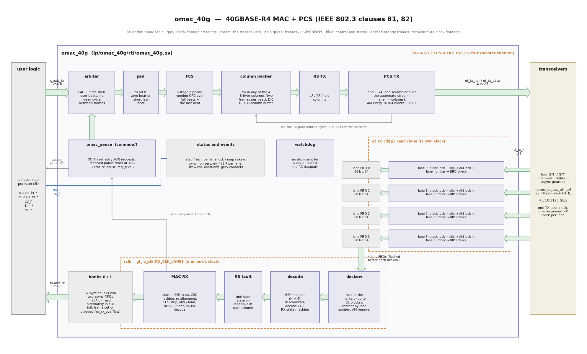

# omac_40g: 40GBASE-R4 MAC + PCS

**Maturity (v0.1.0): hardware-proven** at 40GBASE-CR4 on a ZCU106 with the Opsero 2x QSFP28
FMC against an NVIDIA ConnectX-6 Dx: link on the first power-up, RoCE v2 traffic at line rate in
both directions, PAUSE in both directions, 0 FCS / block / BIP errors ([](hardware.md)).

`omac_40g` is a four-lane Ethernet MAC + 40GBASE-R PCS with a 256-bit AXI-Stream user side on
one clock (156.25 MHz). It implements the omac boundary contract
([](interface.md)) and drives four transceiver lanes at
10.3125 Gb/s in 64B/66B asynchronous gearbox mode
([](gt_usp_gth.md), `omac_gt_usp_gth_x4` for four
UltraScale+ GTH channels). Written from scratch from IEEE 802.3 clauses 81 (RS, XLGMII, link
fault signalling), 82 (40GBASE-R PCS: 64B/66B, multi-lane distribution, alignment markers, BIP,
deskew, lane reorder) and annex 31B (PAUSE); no third-party RTL.

| | |
|---|---|
| line | 40GBASE-R4: four PCS lanes, 4 x 10.3125 Gb/s, no FEC (40GBASE-CR4 / -SR4 / -LR4 without clause 74) |
| user side | 256-bit AXI-Stream TX and RX, `clk` = GT TX user clock 156.25 MHz (40.0 Gb/s per direction) |
| receive clocks | four recovered lane clocks (`gt_rx_clk[3:0]`); the PCS and MAC receive run on one of them (`RX_CLK_LANE`) |
| transceiver | four GTH (or GTY) channels in 64B/66B asynchronous gearbox mode, 64-bit user width |
| lane order | free on transmit, any order on receive (lane numbers from the alignment markers) |
| skew | up to `DESKEW_MAX` = 32 blocks (204.8 ns) between lanes at the receiver |
| status | hardware-proven (ZCU106 + ConnectX-6 Dx); simulated (14 regression tests incl. all 24 lane orders, line rate, Python wire decoder); routed at 156.25 MHz on xczu7ev-2 (16.4k LUT, +1.57 ns) |

No RS-FEC / BASE-R FEC (clause 74), no auto-negotiation (clause 73) or link training: what a
partner forced to 40G with FEC off and autoneg off expects (a ConnectX-6 Dx:
`ethtool -s <if> speed 40000 duplex full autoneg off`, `ethtool --set-fec <if> encoding off`).

## Architecture



| Module | File | Clock | Function |
|---|---|---|---|
| `omac_40g` | `rtl/omac_40g.sv` | all | top: resets, lane instances + FIFOs, crossings, RS transmit mux, PAUSE, watchdog |
| `omac_40g_pkg` | `rtl/omac_40g_pkg.sv` | | AM table (table 82-3), BIP3 (table 82-4), clause 82 block subset, 32-byte CRC helpers |
| `omac_40g_mac_tx` | `rtl/omac_40g_mac_tx.sv` | clk | arbiter (PAUSE first, no dead cycle between frames), pad, FCS, column packer with DIC, underflow / abort as /E/ |
| `omac_40g_pcs_tx` | `rtl/omac_40g_pcs_tx.sv` | clk | `enc66_r4` x4, one scrambler over the aggregate stream, distribution, alignment markers + BIP3, `ce` |
| `omac_40g_lane_rx` | `rtl/omac_40g_lane_rx.sv` | gt_rx_clk[p] | `omac_block_lock`, AM lock , lane number, BIP3 check |
| `omac_40g_pcs_rx` | `rtl/omac_40g_pcs_rx.sv` | rclk | deskew, reorder, AM removal, `omac_ber_mon` (N = 4), descrambler, decoder, receive state machine  |
| `omac_rs_fault` | `common/` | rclk | link fault state (clause 81) on lanes 0-3 of each 8-byte column |
| `omac_40g_mac_rx` | `rtl/omac_40g_mac_rx.sv` | rclk | start + SFD, CRC residue, re-alignment, FCS strip, MIN/MAX length, MAC Control filter, PAUSE decode, bank writes with overflow handling |
| `omac_async_fifo` | `common/` | | lane FIFOs (68 b x `LANE_FIFO_DEPTH`, LUTRAM) and the two RX banks (264 b x `RX_FIFO_DEPTH`/2) |
| `omac_40g_bd` | `rtl/omac_40g_bd.v` | | Verilog wrapper for IP integrator (generated by `scripts/gen_bd_wrapper.py`) |

### Transmit path

* **Arbiter.** At every frame boundary, without a dead cycle (a 64-byte frame is only two
  beats): a pending PAUSE request first (also while `ctl_pause_tx_honour` holds user frames),
  then user beats while `ctl_tx_enable` = 1 and no honoured pause is in force.
* **Pad + FCS.** Bytes beyond `tkeep` are zeroed; frames shorter than 60 bytes get a zero beat
  (28 bytes) or a shortened last beat. The CRC-32 runs in a 3-stage pipeline: over full beats
  as a one-cycle loop (zero-state CRC of beat XOR state); the last beat is right-aligned with
  the state XORed into it, so one fixed 32-byte network handles every length
  (`omac_40g_pkg` explains the identities). A last beat with more than 28 bytes needs one extra
  beat for the FCS.
* **Column packer.** The XLGMII start control character may only sit in lane 0 of an 8-byte
  column (clause 81; the clause 82 block set has no start in lane 4). A 256-bit beat holds
  four columns, so a frame may start in any of the four; the packer appends the /S/ column
  (with preamble + SFD), the frame's data columns, the /T/ column and idles to a buffer of up to
  8 columns and sends four per cycle. Two frames can share a beat (the end of one, the start of
  the next). **AXI-Stream frames always start at `tdata` byte 0**; the shift to the wire column is
  done here.
* **Inter-packet gap / DIC.** The gap from /T/ (inclusive) to the next /S/ is at least
  `12 - DIC_MAX + dic` bytes, the /S/ on an 8-byte boundary; the deficit idle count `dic`
  (0..`DIC_MAX`, default 7) keeps the average at exactly 12 bytes (the clause 46 / 81 deficit
  idle count with the 8-byte alignment of XLGMII: every single gap is 5..19 bytes, every run of
  n gaps sums to at least 12 n - 7). `DIC_MAX` = 3 gives a minimum gap of 9
  bytes at some loss of throughput for frame lengths that are not a multiple of 8.
* **Alignment markers.** Clause 82 inserts one 66-bit marker per lane every 16384 blocks and
  deletes idles to make room. Here the PCS holds the whole transmit path for one cycle per 16384
  (`ce` low: no beat is taken from the user, `s_axis_tx_tready` low) and puts the four markers
  in that cycle's slot; the MAC simply sends 1/16384 fewer beats. On the wire this is
  indistinguishable from idle deletion (markers may fall inside a frame in both cases; the
  receiver removes them). Throughput cost: 0.006 %.
* **RS.** `ctl_tx_fault` sends Local Fault ordered sets (block 0x4B: /Q/ 00 00 01 in lanes 0-3,
  idles in 4-7) in every column; a local fault at our receiver sends Remote Fault (00 00 02); a
  received Remote Fault sends idles. Frames keep being consumed.
* **Errors.** If the next column of a frame is due and no beat is there (`tvalid` low inside a
  frame, after the packer buffer is used up), the frame ends with an /E/ column,
  `ev_tx_underflow` pulses and the rest is drained; `tuser` on a beat does the same with
  `ev_tx_abort`.

**Transmit throughput.** The user side delivers at most one 32-byte beat per cycle, i.e. a
frame of L bytes (without FCS) takes ceil(L/32) cycles at the input, and L + 24 bytes (FCS,
preamble + SFD, 12-byte average gap) on the wire. Every frame size goes out at line rate (less
the 0.006 % of the markers) except L mod 32 = 1..7, where the input is the bottleneck (worst:
L = 65, 3 beats for 89 wire bytes, 93 % of line rate). Measured in simulation: 10,000 frames of
64 bytes (with FCS) back to back in 26,247 cycles = 1.0000 of the line rate (59.5 Mframes/s,
30.48 Gb/s of frame bits), 1,000 frames of 9,600 bytes in 300,342 cycles = 0.9999 (39.91 Gb/s).

### Receive path

* **Per lane, in the lane's recovered clock:** block lock (64 good sync headers; slip on bad
  ones), AM lock (clause 82: a block matching any lane's marker, the same marker 16384 blocks
  later = lock and the PCS lane number of this physical lane; four bad markers in a row = loss),
  BIP3 check of every marker (`ev_rx_bip_error[p]`, the lane's bit error indicator). Blocks go
  into the lane's FIFO with two flags: marker position, and valid marker.
* **Deskew** in `rclk`: once all four lanes are AM-locked with four distinct lane numbers, the
  lane FIFOs are flushed, every FIFO is read up to its next valid marker and held there; when
  all four hold a marker, they are aligned (`stat_block_lock`). If the last marker arrives more
  than `DESKEW_MAX` cycles after the first (`ev_rx_skew_fail`), the FIFOs are flushed and the
  next period is tried. While aligned the marker positions must leave all lanes together (else
  re-alignment); a lane FIFO running empty stalls all four. The measured spread of the last
  alignment is `stat_lane_skew` (blocks), the lane numbers `stat_lane_map`.
* **Reorder, AM removal, BER, descramble, decode.** Output block j = the lane whose marker said
  PCS lane j. The marker column is dropped. The BER monitor counts invalid sync headers of all
  four lanes (97 within 1.25 ms set `stat_hi_ber`). The aggregate stream is descrambled (lane 0
  first), decoded with the clause 82 block subset (0x2D, 0x33, 0x66, 0x55 are invalid), and the
  clause 82 receive state machine runs over the four blocks of each beat in order with the
  one-block look-ahead for /T/. Without alignment or with hi_ber the output is Local Fault.
* **MAC.** A frame starts with /S/ + SFD in lane 0 of a column; frame data starts in the next
  column (byte 8, 16, 24 of the beat or byte 0 of the next one). The first control character
  ends the frame (/T/ = normal, else bad). CRC-32 residue check over frame + FCS. Chunks of 32
  bytes are re-cut from the held beat and the current one so that the frame starts at chunk byte
  0; a chunk is only sent when at least 4 more frame bytes follow it, so the FCS is stripped from
  the last chunk; the end beat can produce two chunks. MIN/MAX length, EtherType 0x8808
  consumed, PAUSE decoded as in omac_10g.
* **Clock crossing.** Chunks alternate between two asynchronous FIFO banks (so two chunks can
  be written in one receive cycle; each bank is written at most once per cycle); the `clk` side
  reads the banks alternately, one beat per cycle. A chunk is only written while the banks keep
  one entry spare afterwards. If they do not (the user clock is slower than the frames arrive,
  see below), the frame is ended with a 1-byte `tuser` = 1 beat in the spare entry or dropped if
  none of it was delivered yet, the rest is discarded and `ev_rx_overflow` pulses. Delivered
  frames are therefore always exact or flagged bad.

**Receive throughput.** The same 32-byte granularity applies: a frame of L bytes without FCS
leaves as ceil(L/32) beats; it took L + 24 wire bytes on average to arrive. All sizes with
L mod 32 = 0 or 8..31 (including 60-byte minimum frames, 1514, 9596) stay below one beat per
cycle even against a far end 200 ppm faster (simulation: 11,000 frames back to back, 0
overflows). Back-to-back frames of the sizes L mod 32 = 1..7 at the minimum average gap need up
to 8 % more beats than cycles (L = 65: 3 beats per 2.78 cycles); the banks (`RX_FIFO_DEPTH` =
64 chunks) absorb bursts of such frames (about 280 back-to-back frames of 65 bytes), and longer
runs lose frames as above. This is a property of a 256-bit, one-frame-per-beat AXI-Stream at 40.0 Gb/s; a 512-bit
or straddled interface would be needed to remove it. RoCE v2 traffic (ACKs of 60/64 bytes,
data at PMTU 1024..4096 + 58 bytes) is not affected; raise `RX_FIFO_DEPTH` (power of two) for
other traffic mixes.

## Instantiation (with the four-lane GTH wrapper)

```systemverilog
omac_gt_usp_gth_x4 #(.CH_OF_LANE(LANE_MAP)) u_gt (  // LANE_MAP: the board's lane order (Board placement)
    .refclk_p(gt_refclk_p), .refclk_n(gt_refclk_n), .freerun_clk(clk_100), .reset_all(gt_reset),
    .gth_rxp(rxp), .gth_rxn(rxn), .gth_txp(txp), .gth_txn(txn),            // [3:0], by QSFP lane
    .tx_usrclk2(mac_clk), .gt_tx_ready(gt_tx_ready), .gt_tx_hdr(gt_tx_hdr), .gt_tx_data(gt_tx_data),
    .rx_usrclk2(gt_rx_clk), .gt_rx_ready(gt_rx_ready), .gt_rx_valid(gt_rx_valid),
    .gt_rx_hdr(gt_rx_hdr), .gt_rx_data(gt_rx_data), .gt_rx_slip(gt_rx_slip),
    .gt_rx_reset_req(gt_rx_reset_req), .gt_loopback(gt_loopback),
    .tx_polarity(4'd0), .rx_polarity(4'd0), .tx_diffctrl(5'b11000), .tx_postcursor(5'd0),
    .tx_precursor(5'd0), .rx_lpmen(1'b0), .gt_powergood());

omac_40g u_mac (
    .clk(mac_clk), .rst(mac_rst),                  // user logic runs on mac_clk too
    .s_axis_tx_tdata(...), /* ... the AXI-Streams, ctl_*, stat_*, ev_* ... */
    .gt_tx_ready(gt_tx_ready), .gt_tx_hdr(gt_tx_hdr), .gt_tx_data(gt_tx_data), .gt_loopback(gt_loopback),
    .gt_rx_clk(gt_rx_clk), .gt_rx_ready(gt_rx_ready), .gt_rx_valid(gt_rx_valid), .gt_rx_hdr(gt_rx_hdr),
    .gt_rx_data(gt_rx_data), .gt_rx_slip(gt_rx_slip), .gt_rx_reset_req(gt_rx_reset_req));
```

`ip/omac_40g/synth/omac_40g_gth_top.sv` is a complete example (the synthesis check of the
pair). Generate the transceiver with `omac_gen_gth_x4 <ip_dir> {<lane0> <lane1> <lane2> <lane3>}`
(gen_gt.tcl; the board's four channel sites in QSFP lane order, lane 0 = master); for an in-memory `synth_design` flow set the IP to global synthesis
(`generate_synth_checkpoint false`, see [](gt_usp_gth.md#global-synthesis)). The logic behind
the MAC connects as in [](interface.md#4-connecting-a-consumer), with a 256-bit stream.

## Board placement

omac_40g itself is board independent. A design determines, for its board and connector: the GT
channel site of each of the four QSFP lanes in lane order (the channel list of
`omac_gen_gth_x4`, lane 0 first: the master), the reference clock input of that quad
(`MGTREFCLK0`) with its pin and its 156.25 MHz source, which must be stable before `reset_all`
is released (for example, a programmable clock generator on the FMC must be programmed first),
the wrapper's `CH_OF_LANE` from the lane order, and the lane polarity where the board swaps P
and N. They come from the board's and the FMC's pinout (for Opsero FMC cards the
[FPGA Board Repository](https://boards.fpgadeveloper.com) generates the constraints); the details
are on [](gt_usp_gth.md#board-placement).

* **The lane order does not matter for the link:** 40GBASE-R lets PCS lanes arrive on any
  physical lane (clause 82; the receiver reorders by the marker lane number), so the partner
  accepts any transmit order, and omac_40g accepts any receive order (`stat_lane_map` shows what
  it found). `CH_OF_LANE` only makes omac_40g PCS lane l leave on QSFP lane l, which keeps
  per-lane debugging readable. In hardware validation the ConnectX-6 Dx sent PCS lane l on QSFP
  lane l (identity map) with 0-1 block of skew.
* `BIT_REVERSE` = 1 (the wrapper default) is right for the UltraScale+ GTH (confirmed on
  hardware: link on the first power-up). The per-lane `tx_polarity` / `rx_polarity` inputs
  exist for boards with P/N swaps (the validation setup had none).

## Bring-up and software

What a design's software does with omac_40g, through the design's own registers (the repository
ships no driver; the register set is in [](interface.md#6-software-contract)). See the
[projects page](projects.md) for a worked example: a design's bring-up code, its registers, its
board placement and its status dump with the per-lane line.

### Sequence

| Step | Software | Wait for | Time |
|---|---|---|---|
| 1 | power-up: transceiver (`reset_all`) and MAC (`rst`) held in reset, `ctl_tx_enable` = `ctl_rx_enable` = 0 | | the reset values of the design's registers |
| 2 | make the reference clock stable at 156.25 MHz (if it comes from a programmable clock generator, for example on the FMC: program it, typically over I2C) | the clock chip's lock / calibration | the chip's own lock time (a fixed wait of some tens of milliseconds after programming is a simple choice) |
| 3 | release `reset_all`, keep `rst` | `gt_tx_ready` = 1 and `clk` running (156.25 MHz) | normally milliseconds; poll every 1 ms with a limit of about 1 s ([](gt_usp_gth.md#resets-and-handshake-software-view)) |
| 4 | release `rst` | | |
| 5 | write `ctl_mac_addr` and the PAUSE values, then `ctl_rx_enable` = `ctl_tx_enable` = 1 (`ctl_loopback` if wanted) | | |
| 6 | poll `stat_link_up` (or take the link-change interrupt) | `stat_link_up` = 1 | the IP itself needs about half a millisecond once the four lanes carry a signal: block lock per lane (in parallel, at most ~22k cycles = 0.14 ms), marker lock (a marker, then the same marker 16384 blocks = 105 µs later: at most 2 periods), deskew (up to one more period per attempt; an attempt that fails because the partner came up in the middle costs one period and counts in `ev_rx_skew_fail`), then the fault states clear. **On hardware, from step 4: a few seconds** (under 6 s against a ConnectX-6 Dx forced to 40000, [](hardware.md#omac_40g-40gbase-cr4)), dominated by the partner's own link-up. Allow 10 s before reporting "no link" |
| 7 | clear or snapshot the counters (the per-lane BIP and skew-fail counts of the acquisition are not errors of the link) | | |

The link partner must be forced to 40 Gb/s with auto-negotiation and FEC off (ConnectX:
`ethtool -s <if> speed 40000 duplex full autoneg off`, `ethtool --set-fec <if> encoding off`).
Software does not need to pulse `rst` while it waits for the link (a pulse is harmless): the RX
watchdog restarts the transceiver's RX datapath every 13.4 ms by itself while the lanes are not
aligned.

### Link loss

* **Detect** it by the falling edge of `stat_link_up` (causes:
  [](interface.md#161-what-stat_link_up-means); at 40G also the loss of alignment: a lane's
  marker lock lost after four bad markers, or the markers of the lanes no longer leaving
  together). Latch both edges, or count link-down events, in the always-on block; a poll every
  100 ms misses short drops. Keep the lane status (`stat_lane_*`) readable in the always-on
  clock: it tells which lane went.
* **While down** the IP keeps working on its own: Remote Fault or idles on transmit (frames are
  still accepted and discarded, `ev_tx_frame` still counts them), the RX watchdog pulses
  `gt_rx_reset_req` every 13.4 ms until the lanes align again. The link comes back without any
  software action once the partner is back.
* **React** in the layers above (hold or flush traffic, note the cause), and at link-up clear or
  snapshot the counters. A `rst` pulse is the "relink" control (a relink leaves errored blocks
  and link-down counts from the acquisition, which is why the counters are judged from link-up
  on). A `reset_all` pulse is needed only after the reference clock was lost or changed; it
  stops `clk`.
* The time to recover after a cable reconnect or a partner restart was not measured separately;
  it is bounded by the partner's own link-up, as in the bring-up times above.

### Loopback

`ctl_loopback` = 1 switches all four transceiver channels to near-end PMA loopback (`LOOPBACK`
3'b010; `LOOPBACK_MODE` = 3'b001 selects near-end PCS at build time). Each lane receives its own
transmitter, so the lanes align at skew 0 with the identity lane map. The change is a link event
(lock, marker lock and alignment are lost and found again, `stat_link_up` drops, frames in
flight are lost). While it is set the partner still receives everything we transmit (the
loopback test traffic too) and nothing it sends reaches us. Software writes the bit, then treats
it as a relink (optionally a `rst` pulse, then wait for `stat_link_up` as at bring-up and
snapshot the counters); this works with the cable to the partner still connected
([](hardware.md#omac_40g-40gbase-cr4)).
Clearing it is the same relink, back to the partner.

### PAUSE (802.3x)

* **What the MAC does by itself:** it consumes every MAC Control frame; a valid PAUSE frame loads
  the receive timer, and `stat_rx_pause_req` stays high for `pause_time` quanta of 512 bit
  times = **12.8 ns = 2 `clk` cycles** at 40G (0xFFFF = 0.84 ms), an XON clears it; with
  `ctl_pause_tx_honour` = 1 it holds its own transmit between frames. On transmit it turns the
  level `ctl_tx_pause_send` into XOFF (rising edge), XOFF refreshes (every `ctl_tx_pause_refresh`
  quanta while high) and one XON (falling edge), sent ahead of data at the next frame boundary
  (without a dead cycle), with `ctl_mac_addr` as the source address.
* **What the design must do:** decide when to ask for PAUSE and drive `ctl_tx_pause_send` from
  hardware (typically a receive FIFO level with hysteresis: ask above a high mark, release
  below a low mark); pick the quanta and the refresh (refresh below the quanta; at 40G 0x100 =
  3.3 µs and 0x80 = 1.6 µs); either set `ctl_pause_tx_honour` = 1 or make its own TX scheduler
  honour `stat_rx_pause_req` (its pause-hold input); give software an enable for each direction.
* **Software** sets those enables and values, and watches `ev_tx_pause` / `ev_rx_pause` (counters)
  and `stat_tx_pause_active` / `stat_rx_pause_req` (live state). Only global 802.3x PAUSE is
  implemented (no priority flow control, 802.1Qbb); the partner must have PAUSE enabled
  (`ethtool -A <if> rx on tx on`).
* **On hardware** ([](hardware.md#omac_40g-40gbase-cr4)): both directions against a ConnectX-6
  Dx; every transmitted XOFF was honoured by the partner, and received PAUSE frames held our
  transmit with no frame lost.

### Counters and a healthy status dump

The per-lane state is what makes a 40G link debuggable; show it to the user in one place. A
healthy link right after link-up reads: `stat_lane_block_lock` = `1111`, `stat_lane_am_lock` =
`1111`, four distinct numbers in `stat_lane_map`, `stat_lane_skew` a few blocks, no BIP errors
on any lane, `ev_rx_skew_fail` 0 or 1, no RX overflow.

Any lane map is legal (four distinct numbers); a skew of a few blocks is normal (0-1 on a 3 m
DAC); one failed alignment attempt at bring-up is normal (the partner came up in the middle of
one). After traffic: bad FCS 0, errored blocks 0, BIP 0 on every lane, skew fails and RX overflow
unchanged since link-up, TX underflow 0, link drops 0.

### When it does not link: debug order

The extra status ports localise a link that does not come up. Check them in this order:

| Step | Look at | Expect | If not |
|---|---|---|---|
| 1 | `gt_powergood`, `gt_tx_ready`, `gt_rx_ready` (wrapper), the measured `clk` | 1, 156.25 MHz | reference clock missing or at the wrong frequency (program the clock chip before `reset_all`), wrong refclk site |
| 2 | `stat_lane_block_lock` | `1111` | a lane without block lock has no usable signal: cable, module, a partner not at 40G (forced to 10G it sends on lane 0 only), a missing lane. Not caused by the bit order or a P/N swap: block lock only tests that the two sync header bits differ, which both keep |
| 3 | `stat_lane_am_lock` | `1111` | block lock without marker lock. **On every lane:** the lanes carry 64B/66B blocks without 40GBASE-R alignment markers (the partner is not in 40GBASE-R4 mode), or the bit order is wrong (`BIT_REVERSE`; 1 is right for the UltraScale+ GTH wrapper). **On one lane:** a P/N swap on that lane (`rx_polarity`). The bit-order and polarity symptoms are derived from the RTL, not observed on hardware |
| 4 | `stat_block_lock` (aligned), `stat_lane_map`, `stat_lane_skew` | 1; four distinct lane numbers; a few blocks | `ev_rx_skew_fail` counting: the lanes are skewed more than `DESKEW_MAX` (32 blocks = 204.8 ns), far beyond any cable; check the RX clocking (each lane's gearbox on its own recovered clock) |
| 5 | `stat_hi_ber`, `stat_local_fault`, `stat_remote_fault` | 0 | remote fault: the partner does not receive us (check the transmit side, including `tx_polarity` per lane and `BIT_REVERSE`, and the partner's link state) |
| 6 | `ev_rx_bip_error` per lane | no counts | a lane with BIP errors has a signal-integrity problem (cable, connector, equalisation `rx_lpmen`, transmit swing `tx_diffctrl`) |
| 7 | `stat_link_up`, then frames: `ev_rx_frame_good`, `ev_rx_fcs_error`, `ev_rx_bad_block`, `ev_rx_overflow` | link up, no errors | FCS errors without BIP errors point at the user side (for example a TX underflow at the far end) |

`RX_CLK_LANE` (default 0) selects the lane whose recovered clock runs the receive PCS and MAC;
if that lane has no signal the whole receive side is stalled, so keep it on a lane that is
always connected.

## Parameters

| Parameter | Default | Description |
|---|---|---|
| `DATA_WIDTH` | 256 | fixed (checked) |
| `MIN_FRAME` | 64 | received frames shorter (with FCS) are bad (`ev_rx_runt`) |
| `MAX_FRAME` | 9600 | received frames longer (with FCS) are cut, bad (`ev_rx_oversize`) |
| `PAUSE_EN` | 1 | 802.3x PAUSE timer and transmission |
| `TX_PAD` | 1 | 0 disables the 60-byte padding (tests only: produces runts) |
| `DIC_MAX` | 7 | deficit idle count range; gaps of `12 - DIC_MAX` .. `19 - DIC_MAX` bytes |
| `AM_PERIOD` | 16384 | blocks per lane per marker (IEEE: 16384; smaller values only for simulation, both ends equal) |
| `DESKEW_MAX` | 32 | lane skew tolerated at the receiver, in blocks of 6.4 ns (32 = 204.8 ns; IEEE 802.3 clause 82 allows 180 ns at the PCS receive) |
| `LANE_FIFO_DEPTH` | 64 | per-lane deskew + clock-crossing FIFO (>= `DESKEW_MAX` + 16) |
| `RX_CLK_LANE` | 0 | physical lane whose recovered clock runs the receive PCS + MAC |
| `SLIP_WAIT` | 256 | cycles after a gearbox slip before headers are tested |
| `BER_TIMER_CLKS` | 195313 | BER window in receive cycles (1.25 ms at 156.25 MHz) |
| `BER_THRESH` | 97 | invalid headers (all lanes) per window for hi_ber |
| `RX_WATCHDOG` | 2097152 | `clk` cycles (13.4 ms) without alignment (or with hi_ber) before `gt_rx_reset_req`; must exceed block lock + 2 marker periods + deskew (~80k cycles) |
| `RX_FIFO_DEPTH` | 64 | RX clock-crossing chunks (two banks of half each, LUTRAM; power of two) |
| `LOOPBACK_MODE` | 3'b010 | GT `LOOPBACK` code for `ctl_loopback` |
| `SCR_INIT` | all ones | scrambler state after reset |

## Ports beyond the contract

The user side is the contract's (docs/interface.md section 1) with `DATA_WIDTH` 256; the GT
side is four lanes of section 2 as packed vectors (lane l = `gt_tx_hdr[2l +: 2]`,
`gt_tx_data[64l +: 64]`, physical receive lane p = `gt_rx_clk[p]`, `gt_rx_valid[p]`,
`gt_rx_hdr[2p +: 2]`, `gt_rx_data[64p +: 64]`, `gt_rx_slip[p]`), one `gt_tx_ready`,
`gt_rx_ready`, `gt_rx_reset_req` and `gt_loopback` for all lanes. In addition:

| Port | Width | Description |
|---|---|---|
| `stat_lane_block_lock` | 4 | block lock per physical lane |
| `stat_lane_am_lock` | 4 | AM lock per physical lane |
| `stat_lane_map` | 8 | PCS lane number found on physical lane p at `[2p +: 2]` (latched at alignment) |
| `stat_lane_skew` | 7 | marker arrival spread of the last alignment, blocks |
| `ev_rx_bip_error` | 4 | a marker's BIP3 did not match (per physical lane) |
| `ev_rx_overflow` | 1 | a received frame was cut or dropped because the RX banks were full |
| `ev_rx_skew_fail` | 1 | an alignment attempt failed (spread > `DESKEW_MAX`) |

`ev_rx_bad_block` / `ev_rx_sequence_error` pulse once per beat (four blocks) with at least one
such block. Frames that start and end inside one beat (at most 23 bytes with FCS) are counted
(`ev_rx_runt`, `ev_rx_frame_bad`) but not delivered; runts of 24 bytes and more are delivered
with `tuser` = 1.

## Timing and constraints

* `clk` 156.25 MHz (6.4 ns); the four `gt_rx_clk` the same nominal frequency, asynchronous to
  `clk` and to each other.
* Constrain every crossing between different clocks of the five (the TX user clock and the four
  recovered RX clocks) with `set_max_delay -datapath_only` of one `clk` period, in an
  **implementation-only** XDC on the channels' `TXOUTCLK` / `RXOUTCLK` pins: 20 ordered pairs,
  written out one by one because an XDC file cannot use `foreach`. The working XDC (validated in
  hardware) and the reasons are on [](gt_usp_gth.md#clock-constraints). All crossings are
  gray-coded FIFOs / event counters, `ASYNC_REG` synchronisers or quasi-static (`ctl_mac_addr`,
  the lane numbers and status).
* Latency (6.4 ns cycles): TX from the first accepted beat to the first block on `gt_tx_*` about
  8 (arbiter, pad, FCS x3, packer, RS, encoder, scrambler, AM stage); RX from the block on
  `gt_rx_*` to `m_axis_rx` about 15 receive cycles + the lane skew + 4-5 `clk` cycles (FIFO).

## Resources and timing

About 16.4k LUT, 8.6k FF and no block RAM on the ZU7EV (7.1 % of the LUTs), routed at
156.25 MHz with 1.57 ns of slack; with the four-lane GTH wrapper 17.2k LUT, 4 GTHE4_CHANNEL,
1 GTHE4_COMMON and 10 BUFG_GT. Every job, the cost per block and the worst paths:
[](resources.md#omac_40g).

## Verification

[](simulation.md) lists the regression. `ip/omac_40g/sim/test_omac_40g.py`
connects two instances back to back through four lanes per direction, each with a block delay
(skew), a lane permutation and the bit-level channel model of omac_10g (`tb_gt_chan`: random
66-bit phase, slip latency, error injection); every receiver lane runs on its own recovered clock
(the far end's TX clock with a random phase), A and B are 100 ppm apart. The wire stream of all
four lanes, as the receiver sees it (permuted, skewed), is decoded by the independent Python
model (`sim/omac_ref.py` `parse_capture_40g`: markers found by table 82-3, period, BIP3/BIP7
by table 82-4 written out bit by bit, deskew, reorder, descramble, clause 82 decode, frames,
gaps). `ip/omac_40g/sim/tb_40g_units.sv` checks the markers and BIP against hand-computed blocks
(e.g. lane 0 after 16383 idle blocks: 0xE1B8896F1E477690), the marker stall, the lane receivers
and the CRC identities.

The results of every test are on [](simulation.md#results). Hardware: [](hardware.md). Not
covered: clause 74 FEC, auto-negotiation, EEE.
